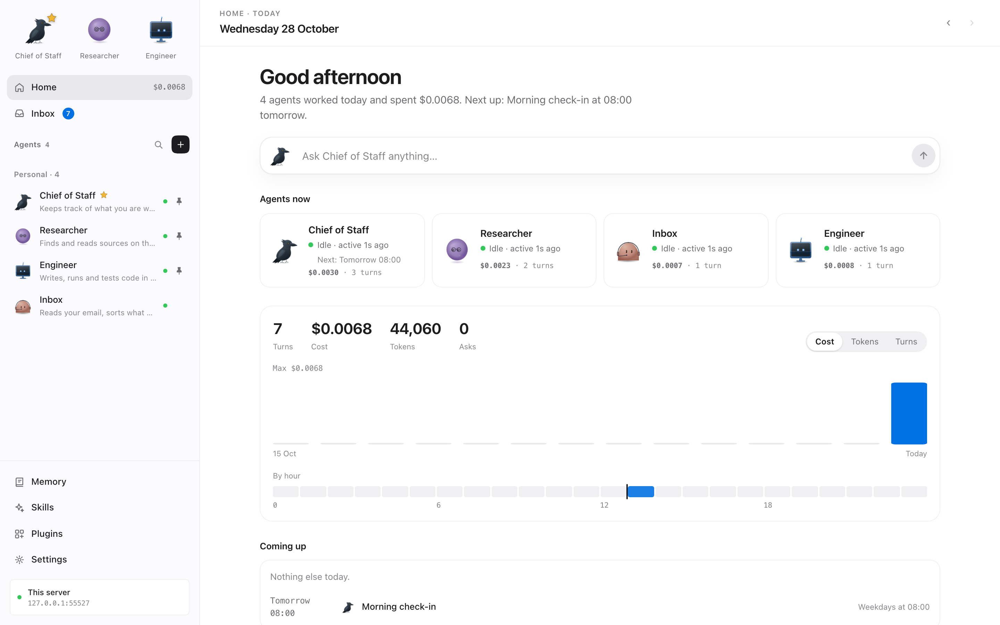
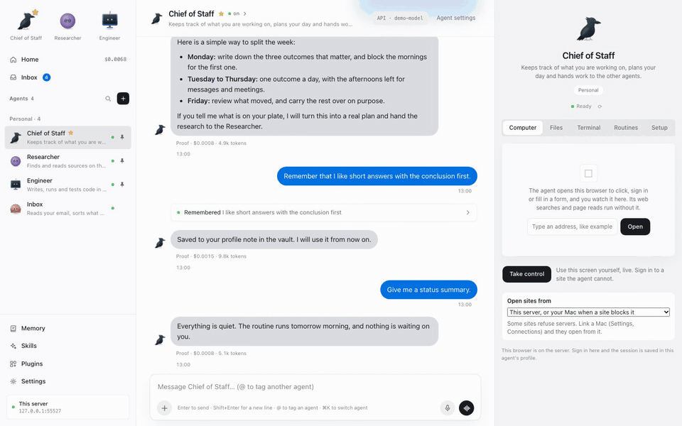
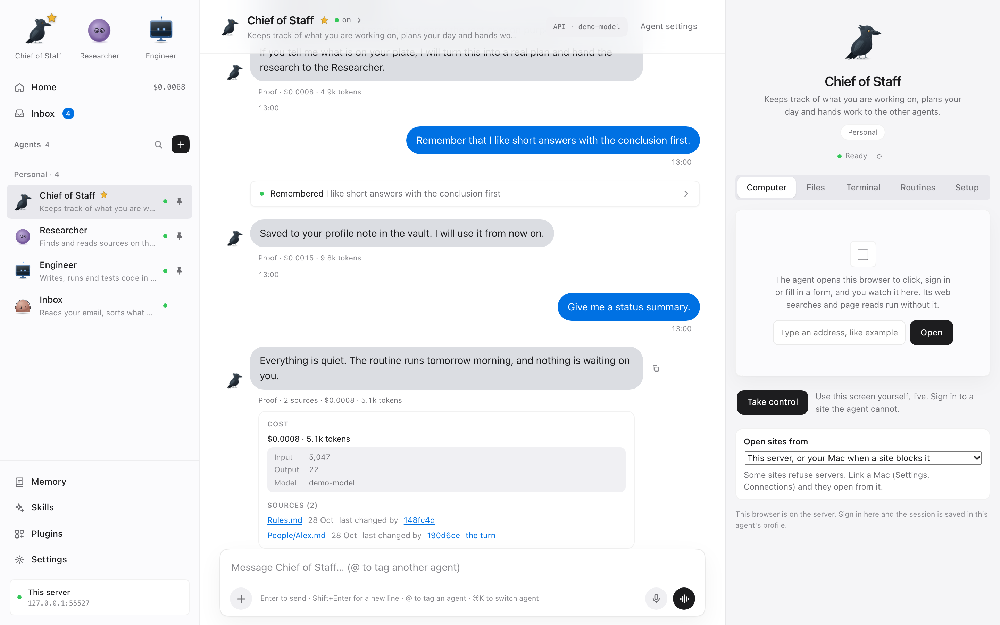

<p></p>

# Ravnir

Persistent agents on your own server, with one shared memory you can read, review and undo.

Give each agent a job, a model and its own browser. It keeps working when you close the tab, runs routines on your server, and brings what it learns back to a shared vault of Markdown notes in git. Use it from your computer or your phone.

<picture>
  <source media="(prefers-color-scheme: dark)" srcset="docs/media/home-dark.png" />
  
</picture>

**[Watch the two minute walkthrough](https://ravnir.dev/assets/walkthrough.mp4)**: first-run setup, an agent using its own browser, shared memory you can review and revert, approvals for commands, routines, and the cost of every reply. Recorded in one real session on a free model; the waits while agents work are sped up.

**Public beta (0.1.0).** Expect rough edges and breaking changes before 1.0. See the [roadmap](docs/roadmap.md).

Ravnir is original software under the [MIT license](LICENSE). There is no official token or coin. Ravnir adds no telemetry; the model providers and services you connect have their own data policies.

## Three things to try

1. **Teach one agent, ask another.** Tell an agent a preference and ask it to remember it. Its commit appears in Memory, and the shared profile note is included in other agents' next turns. Open the diff, follow the link back to the turn, or revert the change. Changes to shared rules and project notes go through proposals for your approval.

   

2. **See what a reply cost.** Each completed turn's final reply shows recorded tokens and cost, with a breakdown. Usage shows the ledger totals; routines show their spend. Set daily or monthly caps and receive a warning at 80 percent. When a provider does not report a price, Ravnir shows that limitation rather than inventing a dollar amount or subscription quota percentage.

   

   The screenshots use demo agents and a scripted model at a made-up price.

3. **Leave a routine running.** Schedule a recurring task or a one-time reminder, then close the app. Failed routines appear in Home's Needs you section. Routines with nothing new can stay quiet while retaining a ledger entry. Stuck turns trigger an alert.

These behaviors have automated tests. The [model report card](docs/model-report-card.md) measures what actual models completed, how often they asked for help, and what the runs cost.

## Install on Linux

One line on a Linux server (it downloads the latest release into `~/ravnir` and runs `./install.sh`; rerun it to update):

```bash
curl -fsSL https://ravnir.dev/install.sh | bash
```

Or by hand:

```bash
git clone https://github.com/ravnir-ai/ravnir.git
cd ravnir
./install.sh
```

The installer uses rootless Podman or Docker, builds the server image, generates a sign-in password, and offers three ways to connect: Tailscale, your own domain with HTTPS, or this computer only. It includes Chromium, Linux desktop tools and a managed OpenCode process. It offers to install Podman if no runtime is available.

Rerun `./install.sh` to update while keeping data and saved settings. Run `./install.sh doctor` to check the installation. `./install.sh uninstall` removes the installation; adding `--purge` also deletes its data.

The installer has been exercised on Ubuntu 24.04 arm64 machines with Podman and Docker. A run with three agents and their browsers open measured 1.38 GiB of RAM. That is a measurement from one setup, not a guaranteed memory limit. Validation on a small amd64 VPS is still pending.

## Run from source

Requires Node.js 22 or newer and git. Python 3 is needed for the interactive terminal; Linux desktop features need the tools included in the server image.

```bash
npm ci
npx playwright install chromium
RAVNIR_VAULT=local npm start
```

Open [localhost:3847](http://127.0.0.1:3847). First run asks for your name and language, connects a model, offers starter agents, and can link the notes vault to a remote git repository. You can use OpenCode or an OpenAI-compatible API, including a local model server such as LM Studio or vLLM.

For a managed OpenCode process, install OpenCode separately and start with `RAVNIR_OPENCODE=managed RAVNIR_VAULT=local npm start`. Otherwise connect an existing OpenCode server or another model endpoint in Settings, Models. Available providers and authentication methods depend on that server.

The default listener is loopback. Ravnir refuses to bind elsewhere without sign-in configured. See the [configuration reference](docs/configuration.md), the in-app `/setup` guide and the [security model](SECURITY.md) before giving agents access to a machine or accounts.

## What agents can do

| Capability | What is available |
| --- | --- |
| Persistent work | A continuing thread, workspace, downloads and browser profile per agent. Closing the tab does not stop a turn. |
| Browser and desktop | Playwright browser tools, step-by-step computer use, a Linux desktop and a live view you can take over to sign in yourself. Jev is an optional speed-up; computer use also works with a model chooser. Many sites refuse server (datacenter) networks; with a [linked Mac](docs/mac-node.md#browse-from-your-mac) those open from the Mac, or an agent can use a proxy you set. |
| Shell and code | A persistent terminal, recorded workspace diffs and tools for files and commands, governed by each agent's approval policy. |
| Shared memory | A Markdown vault in git, source chips in replies, commit history, diffs, proposals, backlinks, Obsidian links and revert. Long conversations also compact into summaries with archived history. |
| Tools and accounts | Plugins, stdio and HTTP MCP connectors, encrypted saved logins, and optional read-only 1Password integration. |
| Collaboration | Agents can message teammates, broadcast to groups and create agents. A question an agent cannot answer goes to the teammates whose job, skills and plugins fit (`ask_team`): a teammate that cannot help passes, the next one is asked, and the answer comes back with who gave it. Work is queued per agent and message chains have a hop limit. |
| Skills and plugins | A shop of tested procedures (writing, research, finance, engineering, design) you give each agent, and a catalog of plugins to connect. Agents search both and ask for what they are missing: you get a card with Add skill, Plug in or Connect, and nothing changes until you press it. |
| Office files | PDF reports, Word documents, Excel workbooks (typed numbers, formats, formulas, totals) and PowerPoint decks, with charts that show in PowerPoint, Keynote and Google Slides. Agents hand them over as file cards, and read the PDF, Word, Excel and PowerPoint files you attach. |
| Saved work | Documents, code, charts, diagrams, HTML artifacts and files with a viewer and version history. |
| Phone and notifications | An installable web app, device pairing, push notifications, approvals and questions. Push support depends on the browser and device. |
| Voice | Browser speech, a compatible speech server, or optional ElevenLabs integration. |
| Recovery | An export archive with agent state, conversations, artifacts and vault history. Secrets are included only when protected with an export passphrase. |

Ravnir is currently designed for one owner with many agents. Native mobile apps, multiple owners and single sign-on are not implemented. Per-agent container computers are optional; host-mode agents share the permissions of the server account. See [SECURITY.md](SECURITY.md).

## Memory and backups

Use `RAVNIR_VAULT=local` for a local git vault, or configure an existing notes clone. Agents can save facts, search notes and propose changes. Memory shows who changed a note, what changed and the originating turn. Revert creates another git commit; it does not erase history. Some changes cannot be reverted automatically, including changes that conflict with later edits.

The optional ai-memory connector remains available, but it is not required to use the shared vault. Do not put passwords or tokens in notes. The writer checks for recognizable secrets, but the vault is readable Markdown and its git history retains previous versions.

Memory's Backup controls can export agent state, conversations, artifacts and the notes vault with its history. Choose a passphrase of at least 10 characters to include saved secrets and the vault deploy key. **The archive as a whole is not encrypted:** notes and conversations remain readable. Keep the archive private.

Restore is for an installation with no agents. Browser profiles, browser sign-ins, installed tools, app sign-in sessions and push registrations are not restored. Agent workspaces are optional at export. For an exact machine recovery, keep a separate protected backup of the full data directory and the server configuration. See [SECURITY.md](SECURITY.md#data-and-backups).

## Model report card

On October 25, 2026, six models each attempted 18 isolated tasks through OpenCode. Each task ran once per model. These are recorded results, not a promise that a model will finish every future task.

| Model | Tasks finished | Mean questions per task |
| --- | --- | --- |
| MiMo 2.6 Flash | 18 of 18 | 0.11 |
| DeepSeek v4.1 Flash | 18 of 18 | 0.11 |
| Qwen 3.8 Flash | 18 of 18 | 0.17 |
| Claude Haiku 5.5 | 17 of 18 | 0.11 |
| GPT-6 Luna | 17 of 18 | 0.17 |
| GLM 5.3 Flash | 14 of 18 | 0.06 |

The lower question count is not always better: two models reported a broken login without asking for help. The [full report](docs/model-report-card.md) includes failures, recorded costs, timings and limits. The [evaluation guide](evals/README.md) explains how to reproduce it; live-model evaluations can incur charges.

## Contribute

Read [CONTRIBUTING.md](CONTRIBUTING.md) for setup, test commands and pull requests. Report vulnerabilities privately using the instructions in [SECURITY.md](SECURITY.md#reporting-a-vulnerability). Feature priorities and remaining release checks are in the [roadmap](docs/roadmap.md).
