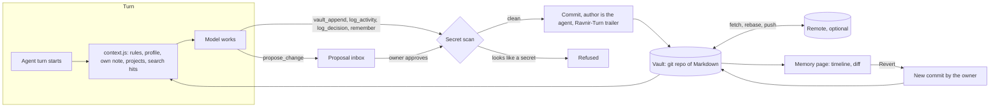

# How Ravnir agents share memory in git

Ravnir agents do not each keep a private memory store. They read and write one vault: a git repository of Markdown notes. Every write is a commit, authored by the agent that made it and linked back to the turn it happened in. You can read the notes in any editor, review a change in a diff, and undo it. This document explains how that works and where it stops.

## The vault

The vault is a normal git working tree. With `RAVNIR_VAULT=local` Ravnir creates one under its data folder, seeded with `Home.md`, `Rules.md` and `Decisions-Log.md` (`server/vault/local.js`). You can instead point Ravnir at an existing notes clone, and a local vault can later be linked to a remote repository. A vault with no remote simply keeps its commits locally (`#sync` in `server/vault/writer.js` returns early when no remote exists).

Fixed locations are the same in every layout: `Agents/`, `Projects/`, `Rules.md` and `Decisions-Log.md`. The daily log and the owner's profile follow a layout preset (`server/vault/layout.js`):

| | `en` | `es` |
| --- | --- | --- |
| Daily log | `Log/<date>.md` | `Registro/<date>.md` |
| Owner profile | `People/<name>.md` | `Perfil/<name>.md` |
| Fact key label | `key` | `clave` |

An existing vault keeps the layout it already has; an empty one follows the owner's language (`detectLayout`). Notes are indexed for full-text search and links in `server/vault/indexer.js`.

## What an agent reads each turn

At the start of every turn, `server/vault/context.js` builds one block of vault knowledge, capped at 6,000 characters by default:

1. `Rules.md` (up to 2,000 characters).
2. The owner's profile note, shared by every agent (up to 1,500 characters; the history section is cut off).
3. The agent's own note in `Agents/` (up to 1,500 characters).
4. Notes in `Projects/` assigned to that agent (up to 700 characters each, more when a live status block is attached).
5. Up to five search hits for the user's message, skipping notes already included.

If the block is too long it is trimmed from the least important end: hits first, then project names, then projects, then the agent's own note. The paths, dates and content hashes of what was injected are recorded as sources, which is how replies can show where an answer came from. Agents can also call `vault_search`, `vault_read` and `vault_links` themselves (`server/vault/tools.js`).

## What an agent can write

Write tools exist only when writing is enabled. Each one is scoped to a path pattern, and the writer refuses anything outside it (`#safe`, `server/vault/writer.js`).

| Tool | Writes to |
| --- | --- |
| `vault_append` | One dated line under `## Learned` in the agent's own `Agents/<name>.md`. |
| `log_activity` | Today's file in the daily log folder. |
| `log_decision` | `Decisions-Log.md`, one line with the date and the agent's name. |
| `remember` | The owner's profile note, under a typed heading. A fact with the same key replaces the old one, which moves to the history section. |
| `propose_change` | Nothing directly. See below. |

`Rules.md` and `Projects/*.md` are not writable by agents. `propose_change` creates a proposal for the owner; only when the owner approves is the exact text applied (`applyProposal`), as a commit authored by the agent with "(approved by ...)" in the subject. The proposal also records the hash of the note it was based on.

## Secrets are refused, not masked

Everything written to the vault is meant to sync to a remote, so the writer scans each piece of text first (`#scan`, using `server/vault/secrets.js`). A write is refused if the text looks like a key or token, a JWT, a `.env` line, a `1Password` reference, a URL with a password or a secret-bearing query parameter, a bot token, a password after the word "password", a long mixed code next to words like "key" or "token", or a high-entropy random string. Plain public links pass. This is pattern matching: it catches recognizable secrets, not every secret.

## Commits and the turn trailer

Each write is one commit. The author is the agent, with an address of the form `<slug>@ravnir.local`, and the committer is Ravnir (`#author`, `#edit`). The subject is `<agent>: <operation> <path>`, and a trailer links the commit to the turn that caused it (`trailerArgs`, `#turn`). For example:

```
Scout: remember People/Alex.md

Ravnir-Turn: 7f3a9c1e
```

Approved proposals add `Ravnir-Proposal: <id>`, and reverts add `Ravnir-Revert: <commit>` (`server/vault/history.js`). The Memory page uses these trailers to jump from a change to the turn behind it.

## Sync and conflicts

With a remote, the writer syncs every two minutes by default and after writes (`syncMs`, `#sync`):

1. Fetch the remote branch.
2. If the vault is only behind, fast-forward. If both sides have new commits, rebase with autostash.
3. Push. If the push is rejected, fetch, rebase once more and retry.

The daily log, decision log and profile folder use git's union merge driver, set up in `.git/info/attributes` (`#ensureAttributes`), so two agents appending lines at the same time rarely clash. If a rebase still fails, the writer pushes the local commits to a branch named `ravnir/conflicto-<stamp>`, resets the vault to follow the remote again, and sends a high-priority notification. Nothing is lost, but you resolve it by hand.

## The Memory page

The Memory page lists commits from `git log` (`vaultLog`), filterable by agent or note, and opens any commit as a diff (`vaultCommit`). Subjects are translated into plain words ("Remembered something about you"). Revert is a new commit made in your name, not a rewrite of history (`revert` in the writer). It refuses when:

- the commit is the first commit of the vault, or is a merge;
- it was already reverted (a later commit carries its `Ravnir-Revert` trailer);
- the vault has uncommitted changes, so a revert never mixes with hand edits;
- a later change touched the same lines, in which case the revert is aborted and the vault is left as it was.

## Export and restore

Memory's backup export (`server/backup.js`) writes a `.tar.gz` with agent state, conversations, approvals and the vault as a git bundle, so history comes along. Saved secrets and the vault deploy key are included only under a passphrase of at least 10 characters, sealed with scrypt. The archive as a whole is not encrypted. Restore is meant for an installation with no agents. It validates the bundle first, and it keeps an existing vault that already has notes instead of replacing it.

## Flow



## Limits

- Revert cannot undo the first commit, merges, repeats, or a change that later edits built on. Anything already pushed stays in the remote's history.
- Secrets that do not look like secrets are not caught, and git history keeps old versions of notes. Do not put credentials in notes.
- Browser profiles, installed tools and workspaces are not part of the vault. Workspaces are only in a backup if you opt in.
- Restore does not bring back browser sign-ins, app sessions or push registrations.
- The vault is a plain git repository, and search is keyword-based (full-text index). Local embeddings exist in `server/vault/embed.js` but are off unless configured.
